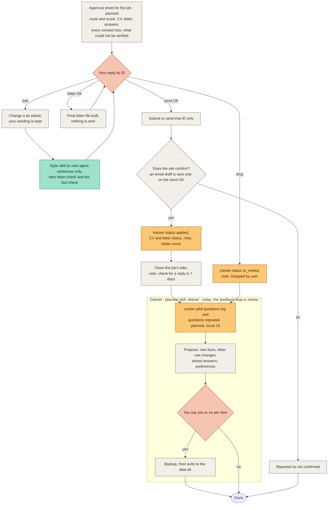

# Target workflow

This file shows the planned flow of the [roadmap, issue 19](https://github.com/kubista9/career-pilot/issues/19), in more detail than [workflow.md](workflow.md). [workflow.md](workflow.md) and the prompts in [`modes/`](../modes) describe what works today. If they disagree with this file, they are right about today.

## How to read the diagrams

Colours say who acts:

| Colour | Who acts |
|---|---|
| Grey | The main agent |
| Blue | A subagent |
| Amber | A `career-pilot` command |
| Coral | You |
| Teal | A skill or connector that is invoked |
| Purple, dashed border | Where the step reads its data from |

The word **planned** in a box means that the box is not built yet. A box without it works today, with one exception: where `run` prepares every job itself, the target splits it into a hunt and a prepare part (see "Open points"). Skill names after "planned skill" are the ones proposed in issue 18.

## Hunt (unattended)

```mermaid
flowchart TD
    start(["career-pilot run"]) --> s0{"Profile complete?"}
    s0 -- no --> setup["Skill: setup · planned<br/>interview until doctor is clean"]:::skill
    setup --> s1
    s0 -- yes --> s1

    subgraph S1 ["1 Load · main agent · planned skill: run"]
        s1["career-pilot doctor<br/>stop if a required key is missing"]:::cmd --> s1b["Read the sources"]:::agent
        d1["Reads: the profile through career-pilot brief,<br/>sources.facts, sources.letter_rules,<br/>cvs and sources.cv_dir, cv.md, _profile.md, _custom.md"]:::data -.-> s1b
    end
    s1b --> s2

    subgraph S2 ["2 Sync · main agent · planned skill: sync"]
        s2["Read email, read only"]:::agent --> s2b["Read the boards' tracker pages"]:::agent
        s2b --> s2c["tracker status and tracker add"]:::cmd
        s2c --> s2d["tracker followups<br/>who is due a follow-up"]:::cmd
        s2d --> s2e["Draft follow-up emails<br/>nothing is sent"]:::agent
        d2["Reads: adapters.gmail, sync.email_days,<br/>boards tracker_urls, followup.stale_days,<br/>followup.rejected_within_days, followup.skip_routes"]:::data -.-> s2
    end
    s2e --> s3

    subgraph S3 ["3 Search · subagents · planned skill: search"]
        s3["One browser subagent per board,<br/>at most three at once"]:::sub --> s3b["Run the groups of the current stage"]:::sub
        s3b --> s3c["tracker find<br/>before a result is opened"]:::cmd
        s3c --> s3d["Read each opened listing in full,<br/>return a structured list"]:::sub
        d3["Reads: boards search_url, search.location, search.pages,<br/>search.groups with stage, keywords, locations,<br/>radius_km, max_age_days, boards and note"]:::data -.-> s3
    end
    s3d --> s4

    subgraph S4 ["4 Filter and score · main agent · planned skill: search"]
        s4{"Dropped by a hard filter?"}:::agent
        s4 -- no --> s4b{"tracker find:<br/>duplicate or similar?"}:::cmd
        s4b -- similar --> s4c["Warning: open it and compare"]:::agent
        s4c --> s4d
        s4b -- new --> s4d["Pick the track, rate each criterion<br/>with evidence from the listing"]:::agent
        s4d --> s4e["career-pilot score<br/>total, gates, minimums, route"]:::cmd
        s4e --> s4f{"Route is dropped?"}:::cmd
        s4f -- no --> s4g["List the knock-outs"]:::agent
        d4["Reads: filters for title words, years and closed listings,<br/>tracker.file, scoring.tracks with criteria, rubric,<br/>gates, min and threshold, routing, routes"]:::data -.-> s4
    end
    s4 -- yes --> skip["Skipped, not stored"]:::agent
    s4b -- duplicate --> skip
    s4f -- yes --> skip
    s4g --> more{"Enough usable jobs?<br/>search.next_stage_below"}:::agent
    more -- no, a stage is left --> s3
    more -- yes --> cap{"Daily cap reached?<br/>daily_caps, no command counts today"}:::agent
    cap -- yes --> over["tracker add as to_review,<br/>note: over daily cap"]:::cmd
    cap -- no --> auto{"Is routes.ROUTE.auto_submit true?"}:::agent

    subgraph S6 ["6 Auto-submit · only on routes you switched on"]
        a1["Prepare with the fixed CV"]:::agent --> a2{"Every check passes?<br/>answers known, CV confirmed,<br/>no login, CAPTCHA or legal box"}:::agent
        a2 -- yes --> a3["Submit and wait for<br/>the site's confirmation"]:::agent
        a2 -- no --> a4["Left open: blocked"]:::agent
    end
    auto -- yes --> a1
    auto -- no --> s7
    over --> s7
    a3 --> s7
    a4 --> s7

    subgraph S7 ["7 Log and summarise · main agent · planned skill: search"]
        s7["tracker add, tracker status,<br/>tracker counts, tracker check"]:::cmd --> s7b["Summary with next steps per job"]:::agent
    end
    s7b --> pick{"You pick jobs by ID<br/>planned: today run prepares first"}:::you

    classDef agent fill:#F1EFE8,stroke:#5F5E5A,color:#2C2C2A
    classDef sub fill:#B5D4F4,stroke:#185FA5,color:#042C53
    classDef cmd fill:#FAC775,stroke:#854F0B,color:#412402
    classDef you fill:#F5C4B3,stroke:#993C1D,color:#4A1B0C
    classDef skill fill:#9FE1CB,stroke:#0F6E56,color:#04342C
    classDef data fill:#EEEDFE,stroke:#534AB7,color:#26215C,stroke-dasharray:4 3
```

## Prepare (attended, batches of 5)

```mermaid
flowchart TD
    pick{"You pick jobs by ID"}:::you --> p0

    subgraph P0 ["Preflight · main agent · planned skill: apply"]
        p0["Open every portal of the batch, read only"]:::agent --> p0b{"Sign-in or account needed?"}:::agent
        p0b -- yes --> p0c["You sign in,<br/>all portals asked at once"]:::you
    end
    p0b -- no --> p1
    p0c --> p1

    subgraph P1 ["Per job · one subagent per job, at most three at once"]
        p1["Job folder and description file"]:::sub --> p2{"Does the form ask for a CV?<br/>the whole form is read"}:::sub
        d5["Reads: tracker.applications_dir,<br/>the listing, the application form"]:::data -.-> p1
    end
    p2 -- not asked --> n1["No CV attached,<br/>CV recorded as not_needed"]:::sub

    subgraph CV ["CV · planned skill: cv"]
        c1["Content plan<br/>from the facts and the listing · planned"]:::agent --> c2["Design connector: copy the template,<br/>fill it, export a PDF · planned"]:::skill
        c2 --> c2y["You approve the save · planned"]:::you
        c2y --> c3{"career-pilot ats-check passes?<br/>planned"}:::cmd
        c3 -- no --> c4["Fixed CV chosen<br/>by focus and language"]:::agent
        d6["Reads: cvs with focus and language, sources.cv_dir,<br/>sources.facts, cv.md, the CV builder keys · planned"]:::data -.-> c1
    end
    p2 -- required or optional --> c1

    c3 -- yes --> ln
    c4 --> ln
    n1 --> ln{"Letter needed?<br/>the route needs approval,<br/>or the form requires one"}:::agent

    subgraph LT ["Letter · planned skill: letter"]
        l1["Plan, if letters.plan_first"]:::agent --> l1y{"You confirm the plan"}:::you
        l1y --> l2["Draft from the facts<br/>and the letter rules"]:::agent
        l2 --> l3["Your style skill rewrites the draft<br/>letters.style_skill"]:::skill
        l3 --> l4["career-pilot letter-check"]:::cmd
        l4 --> l5["Every sentence checked<br/>against the facts"]:::agent
        d7["Reads: sources.letter_rules, sources.facts,<br/>letters limits and banned phrases, the listing"]:::data -.-> l2
    end
    ln -- yes --> l1
    ln -- no --> f1

    subgraph FM ["Form · planned skill: apply · form subagent, one per shared login"]
        f1["Fill every section, upload the CV"]:::sub --> f2["Read the values back<br/>after each page"]:::sub
        f2 --> f3["Report missing facts, consent boxes,<br/>CAPTCHA and account steps"]:::sub
        d8["Reads: form_facts, then answers,<br/>then candidate, then the facts files"]:::data -.-> f1
    end
    l5 --> f1
    f3 --> q["Missing facts asked in one batch,<br/>you tick the consent boxes"]:::you
    q --> sheet["Approval sheet for the job · planned"]:::agent

    classDef agent fill:#F1EFE8,stroke:#5F5E5A,color:#2C2C2A
    classDef sub fill:#B5D4F4,stroke:#185FA5,color:#042C53
    classDef cmd fill:#FAC775,stroke:#854F0B,color:#412402
    classDef you fill:#F5C4B3,stroke:#993C1D,color:#4A1B0C
    classDef skill fill:#9FE1CB,stroke:#0F6E56,color:#04342C
    classDef data fill:#EEEDFE,stroke:#534AB7,color:#26215C,stroke-dasharray:4 3
```

## Approve, send, debrief

## The steps

Today there is one skill, `career-pilot`, with the modes `run`, `sync` and `review`. The "Skill" row names the skill planned in [issue 18](https://github.com/kubista9/career-pilot/issues/18) for each step. Those names are proposals. Paths such as `_custom.md` are in the data dir.

### 1 Load

Checks that the profile is complete and the files it points to can be read, before any work starts.

| | |
|---|---|
| Who does it | Main agent, with a `career-pilot` command |
| Reads | `config/profile.yml` through `career-pilot brief`, `sources.facts`, `sources.letter_rules`, `sources.cv_dir`, `cvs`, `cv.md`, `modes/_profile.md`, `modes/_custom.md` |
| Commands | `career-pilot doctor`, `career-pilot brief` |
| Skill | Today: `career-pilot`, mode `run`. Planned: `run` (calls the other skills in order) |
| Status | Works today |

### 2 Sync

Brings the tracker up to date from email and the boards' own pages, then drafts follow-up emails. Nothing is sent.

| | |
|---|---|
| Who does it | Main agent. Email and board pages are read, never changed |
| Reads | `adapters.gmail`, `sync.email_days`, `boards[].tracker_urls`, `followup.stale_days`, `followup.rejected_within_days`, `followup.skip_routes`, `tracker.status_folders`, `sources.letter_rules`, `modes/_custom.md` |
| Commands | `career-pilot tracker status`, `tracker add`, `tracker followups`, `tracker followup` |
| Skill | Today: `career-pilot`, mode `sync`, also called from `run`. Planned: `sync` |
| Status | Works today. The split into its own skill is planned (issue 18) |

### 3 Search

Finds new listings on every board, in stages, so a second language is searched only when the first runs dry.

| | |
|---|---|
| Who does it | One browser subagent per board, at most three at once. The main agent keeps the duplicate decisions |
| Reads | `boards[].search_url`, `search.location`, `search.pages`, `search.next_stage_below`, `search.groups` (`stage`, `keywords`, `locations`, `location`, `radius_km`, `max_age_days`, `boards`, `pages`, `note`) |
| Commands | `career-pilot tracker find` before a result is opened (`run.md`, step 3). The prompts do not say whether the subagent or the main agent runs it. A subagent sees neither the skill nor the profile (`SKILL.md`, "Subagents"), so the brief must carry what it needs |
| Skill | Today: `career-pilot`, mode `run`. Planned: `search` |
| Status | Works today. The per-board filter blocks and the query log in issue 19 phase 5 are planned |

### 4 Filter and score

Drops what cannot fit, removes duplicates, rates the rest and picks a route.

| | |
|---|---|
| Who does it | Main agent. `career-pilot score` does the arithmetic |
| Reads | `filters` (`title_words`, `max_required_years`, `drop_closed`), `tracker.file`, `scoring.tracks` (`criteria`, `rubric`, `gates`, `min`, `threshold`), `routing`, `routes`, `daily_caps` |
| Commands | `career-pilot tracker find`, `career-pilot score` |
| Skill | Today: `career-pilot`, mode `run`. Planned: `search` |
| Status | Works today, including the knock-outs list (`run.md`, step 4, item 7) |

The daily cap is checked here (`run.md`, step 4, item Caps). The profile holds the cap (`daily_caps.approval`, `daily_caps.auto_submit`). No prompt says where the count of jobs prepared or submitted today comes from, and no command gives it. `career-pilot tracker counts` returns jobs per status and per route over the whole tracker, with no date. `tracker list` filters by status and route only. The tracker has `found` and `updated` dates, but no command filters on them. Today the agent has to count the rows itself. This is the kind of arithmetic that AGENTS.md says belongs in a command.

### 5 Prepare

Gets one application ready: folder, CV, letter and form. In the target it runs only for jobs the user picked, in batches of 5. Today `run` prepares every job that is not over the cap, in batches of 5 (`run.md`, step 5), and fills the form without submitting it.

#### 5a Preflight

Opens every portal of the batch read only, so all sign-ins are asked for at once.

| | |
|---|---|
| Who does it | Main agent, then you |
| Reads | `boards`, the application links of the batch |
| Commands | None |
| Skill | Planned: `apply` |
| Status | Works today (`_shared.md`, "Using subagents"; `run.md`, step 5). You sign in: the agent never logs in (safety rule 2). The skill name `apply` is planned |

#### 5b CV

Decides whether the form asks for a CV and picks or builds one.

| | |
|---|---|
| Who does it | Today: the main agent or the job's subagent, which picks a CV by `focus` and language. Planned: the `cv` skill with a design connector, and you approve each save |
| Reads | `cvs` (`file`, `focus`, `language`), `sources.cv_dir`, `sources.facts`, `cv.md`, the listing and the whole form. Planned: the CV builder keys, not named yet |
| Commands | None today. Planned: `career-pilot ats-check` (issue 9) |
| Skill | Today: `career-pilot`, mode `run`. Planned: `cv` |
| Status | Choice by focus and the required, optional or not asked check work today. Tailored CV: planned (issue 10). `ats-check`: planned (issue 9) |

Today a design tool is opened only when `modes/_custom.md` says so and a step needs it (`run.md`, step 1).

#### 5c Letter

Writes the cover letter only when the route needs approval or the form requires one.

| | |
|---|---|
| Who does it | Main agent, or the job's subagent. A subagent does not see skills (`_shared.md`, "Answers and letters"), so the main agent runs the style skill on its draft |
| Reads | `sources.letter_rules`, `sources.facts`, `letters` (`plan_first`, `min_chars`, `max_chars`, `min_paragraphs`, `max_paragraphs`, `min_paragraph_chars`, `banned_phrases`, `forbidden_claims`, `forbidden_patterns`, `allow_dashes`, `style_skill`), the listing, the CV chosen |
| Commands | `career-pilot letter-check` |
| Skill | Today: `career-pilot`, plus the user's own style skill named in `letters.style_skill`. Planned: `letter` |
| Status | Works today, including the style skill. Today the user confirms a plan in `review` mode. In an unattended `run` the letter is marked "plan not confirmed" |

#### 5d Form

Fills the form and reads the values back so a wrong value is found before the user sees the sheet.

| | |
|---|---|
| Who does it | A form subagent, one per job. Jobs that share a login run one after the other, and at most three run at once (`_shared.md`, "Using subagents"). You answer the missing facts in one batch and tick the consent boxes |
| Reads | `form_facts`, then `answers`, then `candidate`, then the facts files (`_shared.md`, "Filling application forms") |
| Commands | None |
| Skill | Planned: `apply` |
| Status | Works today: `form_facts`, the form subagents and the preflight. The read-back after each page is a rule in "Filling application forms", not a command. The facts register and lookup is a separate item: planned (issue 15). Approval sheet: planned (issue 4). Step 5 fills the form, and on a route without `auto_submit` nothing is submitted until approval (`run.md`, steps 5 and 6) |

### 6 Apply and auto-submit

Submits where a route has `auto_submit` on and every check passes. Everything else waits for the user.

| | |
|---|---|
| Who does it | Main agent |
| Reads | `routes.<name>.auto_submit`, `answers`, `sources.facts`, `cvs`, `daily_caps.auto_submit` |
| Commands | None. The count against `daily_caps.auto_submit` has no command (see step 4) |
| Skill | Today: `career-pilot`, mode `run`. Planned: not decided (see "Open points") |
| Status | Works today. A route without `auto_submit` submits nothing: the form stays filled and open for `review` (`run.md`, step 6) |

### 7 Log and summarise

Writes every job to the tracker and ends the run with the summary and next steps per job.

| | |
|---|---|
| Who does it | Main agent, with `career-pilot` commands |
| Reads | `tracker.file`, `tracker.applications_dir`, `adapters.notion` |
| Commands | `career-pilot tracker add`, `tracker status`. `tracker counts` and `tracker check` exist, but no mode names them: `run.md`, step 7 says "Count from the tracker" |
| Skill | Today: `career-pilot`, mode `run`. Planned: `search` for the summary, called from `run` |
| Status | Works today. The approval sheet that replaces the next steps text is planned (issue 4) |

### Review and send

Handles the user's answer for one ID: an edit, a letter OK, a send OK or a drop. Only a send OK sends.

| | |
|---|---|
| Who does it | Main agent. You decide |
| Reads | `answers`, `sources.facts`, `sources.letter_rules`, `cvs`, `letters`, `tracker.*`, `adapters`, the job's `application-notes.txt` |
| Commands | `career-pilot letter-check`, `career-pilot tracker status` |
| Skill | Today: `career-pilot`, mode `review`. Planned: `apply` (sending after your OK) |
| Status | Works today. The approval sheet is planned (issue 4) |

### Debrief

Turns the user's corrections into saved facts, letter rules and answers, after each batch.

| | |
|---|---|
| Who does it | Main agent. You say yes or no per item |
| Reads | The user's edits, `sources.facts`, `sources.letter_rules`, `answers` |
| Commands | None today. Planned (issue 16): `career-pilot questions log` and `career-pilot questions repeated`, not built |
| Skill | Today: `career-pilot`, mode `review`, section "Feedback loop". Planned: `debrief` |
| Status | The feedback loop works today (`review.md`, "Feedback loop"). The debrief step and its question log are planned (issue 16) |

### Setup

Interviews a new user until `career-pilot doctor` is clean.

| | |
|---|---|
| Who does it | Planned: the `setup` skill, with you |
| Reads | `config/profile.example.yml`, `cv.example.md`, `modes/_*.template.md`, `examples/` |
| Commands | `career-pilot doctor`, `career-pilot setup-check` (both exist) |
| Skill | Planned: `setup` |
| Status | Planned (issue 17). Today the user copies the examples by hand (`docs/getting-started.md`) |

## Open points

- **Where auto-submit sits after the split.** The diagram keeps it in the hunt, with the fixed CV, because a tailored CV needs the user's approval per save and the hunt has no user. Not decided.
- **The daily cap count has no command.** Step 4 above. `run.md`, step 4 and `_shared.md`, safety rule 7 name the cap but not how to count.
- **Email in `sync`: three lines disagree.** `_shared.md`, safety rule 11 says email is read-only in `sync` and sends only for approved applications. `sync.md`, step 1 says never draft. `sync.md`, step 5 drafts follow-ups. This is M1 in issue 19.
- **Follow-up reasons: two lines disagree.** `sync.md`, step 5 (last paragraph) says no draft when the rejection gives a clear reason. `sync.md`, step 5 item 2 says skip a rejection with a detailed reason only if `_custom.md` says so. This is M2 in issue 19.
- **Asking the user inside `run`.** `run.md`, intro now lists the only points where the run asks (sign-ins, missing facts, consent boxes, claims to confirm) and says what happens without an answer: the job is left open as `to_review` with a note. This is a stopgap. The attended prepare part still does not fit an unattended hunt, so the split still removes it.
- **Who runs `tracker find` in the search step.** `run.md`, step 3 says to open a result only if the tracker does not know it, but a search subagent has no profile (`SKILL.md`, "Subagents"). Not stated which agent runs the command.
- **Style skill and subagents.** `_shared.md`, "Answers and letters" says a subagent does not see skills. With one letter subagent per job, the main agent has to run the style skill on each draft, or the subagent needs access. Not decided.
- **Skill names.** The names in the diagrams are the eight proposed in issue 18: `setup`, `search`, `cv`, `letter`, `apply`, `sync`, `debrief` and `run`. Issue 18 decides them.
