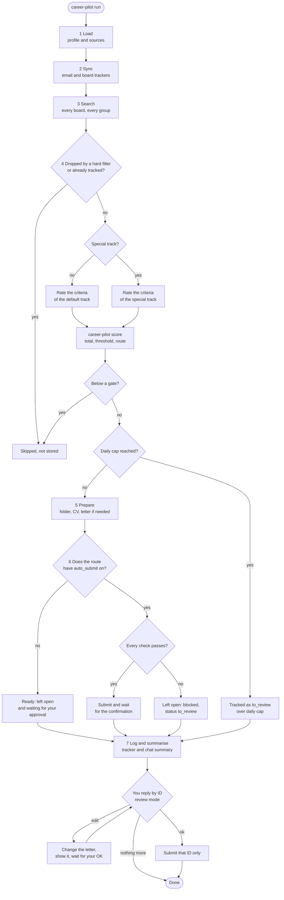

# Workflow

The prompts in [`modes/`](../modes) are the single source of truth for what the skill does. This diagram only
shows the same flow at a glance. If the two ever disagree, the prompts are right.

## The seven steps

| Step | What happens | Mode file |
|---|---|---|
| 1 Load | Check the profile and the files it points to | [run](../modes/run.md) |
| 2 Sync | Update statuses from email and the boards' own "applied" pages | [sync](../modes/sync.md) |
| 3 Search | Run the search plan on every board | [run](../modes/run.md) |
| 4 Filter and score | Drop, deduplicate, rate, score, route | [run](../modes/run.md) |
| 5 Prepare | Job folder, CV choice, contact, letter if needed | [run](../modes/run.md) |
| 6 Apply | Submit only where the route allows it. Everything else waits | [run](../modes/run.md) |
| 7 Log and summarise | Tracker, summary, the question for you | [run](../modes/run.md) |
| after the summary | Edits, approvals, feedback | [review](../modes/review.md) |

## Five things the diagram makes visible

- **Hard-filter exit**: a job that fails a filter or a gate is dropped and not stored.
- **Special track**: an optional second scoring track (for example a thesis project) with its own criteria.
- **Approval gate**: a route without `auto_submit` never submits. The page waits for you.
- **Daily cap**: past `daily_caps`, jobs are tracked but not prepared.
- **Review loop**: an edit is never an approval. Only an explicit OK for an ID sends it.
